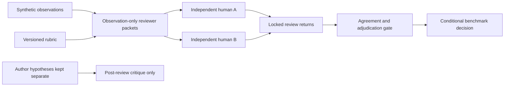

# Feasibility architecture decision

Status: accepted for packet tooling only. Product stack remains conditional.
Packet contract revision 0.2.0 supports a standalone public checkout without
local author hypotheses. There is still no ticket-classification component.

## Decision and alternatives

Use JSON for synthetic observations, CSV for independent labels, Markdown for
the rubric, and Python 3.11+ standard library for integrity checks. This matches
existing Howl CLI/file contracts without requiring a server or runtime packages.

| Alternative | Benefit | Cost at this stage |
| --- | --- | --- |
| Python standard library | Portable data checks, existing ecosystem fit | Interpreter distribution and strict input validation needed |
| Go | One binary, explicit types | Build/distribution work without experimental benefit |
| C#/.NET | Strong types, familiar API platform | Runtime and integration work for a file-based study |
| Existing QA configuration | Avoid building a redundant analyzer | Must test availability, privacy and portability constraints |
| Spreadsheet only | Accessible manual review | Harder reproducibility and accidental formula/label edits |

No analysis model, API, service, database, adapter framework or autonomous
escalation is implemented. Python is not a commitment to a full product stack.

## Evidence flow

The packet checker reads local files, validates shape and compares hashes. It
does not execute message contents or fetch links. It does not assess whether a
response was appropriate. No raw real incident evidence is included.

PacketVerifier owns the packet root and validation workflow. Shared bounded
reads enforce path boundaries; shared JSON decoding rejects ambiguous keys.
The CLI and verify(root) compatibility entry point call that same object.
Stateless case validation remains a function. This uses OOP for responsibility
and DRY for validation reuse without adding an inheritance hierarchy.

Local author hypotheses are outside the public manifest and distribution.
Review packets are separate physical copies for handoff, verified against one
canonical case set. No private file is necessary to run public regression.
